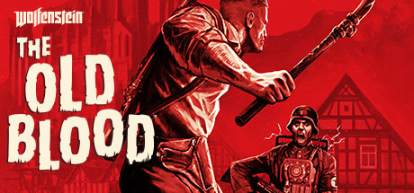

**Wolfenstein: The Old Blood is a standalone prequel to The New Order, sending BJ Blazkowicz to Castle Wolfenstein to steal Deathshead's secret files. Features brutal combat against Nazi occult enemies and atmospheric horror sequences.**

---

## 📖 About

Wolfenstein: The Old Blood is a standalone prequel to The New Order, sending BJ Blazkowicz to Castle Wolfenstein to steal Deathshead's secret files. Features brutal combat against Nazi occult enemies and atmospheric horror sequences.

## ⚠️ Problems Without Trainer

| Problem | Status |
|---------|--------|
| **Über Difficulty** — Highest difficulty provides almost no health or armor pickups | ✅ Solved |
| **Pipe Segment Routing** — Using pipes for traversal has imprecise grab detection | ✅ Solved |
| **Enemy Density** — Chapter 7's Zombie Nazi segment is particularly brutal without resource planning | ✅ Solved |
| **Short Campaign** — Completable in 4-5 hours making it feel light on value | ✅ Solved |

## ✅ Solution

The **Wolfenstein: The Old Blood Trainer** solves all these issues by giving you complete control over the game.

## 🎯 Full Feature List

- Unlimited Resources
- God Mode / Invincibility
- Instant Skill Cooldown
- One-Hit Kill
- Freeze Game Timer
- Unlock All Items & Achievements
- Custom Speed Multiplier
- Save State Anywhere

## 🚀 Quick Start

1. **Disable Windows Defender** temporarily (trainer may trigger false positive)
2. Download the trainer from the button above
3. Launch Wolfenstein: The Old Blood
4. Run the trainer as Administrator
5. Activate desired cheats with hotkeys

## 💎 Free vs Paid

| Feature | Free | Pro |
|---------|------|-----|
| Basic God Mode | ✅ | ✅ |
| Unlimited Resources | ✅ | ✅ |
| All Advanced Cheats | ❌ | ✅ |
| Auto-Updates | ❌ | ✅ |
| Priority Support | ❌ | ✅ |

## 💻 Requirements

- Windows 10/11 (64-bit)
- Wolfenstein: The Old Blood (any version)
- .NET Framework 4.8+
- DirectX 11+

## 🍎 macOS

macOS users can use our alternative tool:

## ⚖️ Legal

This trainer is for educational and single-player use only. Use responsibly.

---

